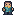
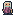
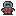
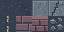

# Художественные ресурсы «Город без света»

Статичный пиксельный набор, созданный с нуля для проекта. Сторонние изображения, шрифты и готовые наборы графики в PNG не использовались. Это самостоятельные исходные изображения, **не замена прототипов и не интеграция в игру**.

Основание: [архитектура](../../PROJECT_ARCHITECTURE.md), [контракт](../../INTEGRATION_CONTRACT.md), [реестр задач](../../TASKS.md). Исходные документы проверены на `main`, коммит `add6245cae444c433e4fc1f7f04e239142243728`; перед передачей ветка обновлена до `d0e98ada4ce9bd47b0fef9bb2043024276b4f523` с принятой основой `BASE-01`, требования к графике повторно проверены. До создания файлов пользователь подтвердил предложенные пути, состав и размеры в ответ на запрос согласования с архитектором. Набор не закрывает целиком отложенную задачу `POST-01`; реестр остаётся за архитектором.

## Файлы и размеры

Все пути ниже относительны этого каталога; в Godot им соответствует префикс `res://assets/art/`.

| Ресурс | Превью | Размер PNG | Назначение |
|---|---|---|---|
| [world/hero.png](world/hero.png) |  | 16 × 16 | Герой |
| [world/mira.png](world/mira.png) |  | 16 × 16 | Мира |
| [combat/enemy.png](combat/enemy.png) |  | 16 × 16 | Визуальный образ противника |
| [world/tiles.png](world/tiles.png) |  | 64 × 32 | Восемь клеток по 16 × 16 |

Превью увеличены только средствами этого документа. Исходные PNG имеют указанные выше точные размеры. Персонажи — одиночные статичные изображения, условно обращённые к нижнему краю экрана; кадров анимации и направлений здесь нет. Игровые ID и поведение противника определяет существующий контракт, а не имя изображения.

## Атлас клеток

Начало координат — верхний левый угол PNG. Порядок — слева направо, затем следующая строка. Сетка **4 столбца × 2 строки**, без промежутков, полей и внешней обводки.

| Индекс | Область `(x, y, width, height)` | Описание |
|---|---|---|
| 0 | `(0, 0, 16, 16)` | Асфальт |
| 1 | `(16, 0, 16, 16)` | Асфальт с трещинами; та же основа, что у клетки 0 |
| 2 | `(32, 0, 16, 16)` | Бетонная тротуарная плита |
| 3 | `(48, 0, 16, 16)` | Повреждённая плита; та же основа, что у клетки 2 |
| 4 | `(0, 16, 16, 16)` | Вертикальная дорожная разметка на асфальте; разрывы продолжаются при вертикальном повторении |
| 5 | `(16, 16, 16, 16)` | Верх кирпичной стены |
| 6 | `(32, 16, 16, 16)` | Фасад кирпичной кладки |
| 7 | `(48, 16, 16, 16)` | Обломки на асфальте; декоративный рисунок на основе клетки 0 |

Для индекса `i` начало клетки: `(16 * (i % 4), 16 * (i // 4))`. Индексы и описания относятся только к раскладке изображения; новые игровые ID не вводятся. Коллизии, проходимость, слои и правила соединения стен здесь **не задаются**. Верх и фасад стены — отдельные рисунки, не готовая система автотайлинга.

## Палитра и формат

Общий стиль — приглушённый сине-серый город с локальными тёплыми акцентами. Основные цвета:

| Роль | Цвет |
|---|---|
| Контур персонажей | `#171d2a` |
| Куртка героя / светлый акцент | `#367f89` / `#68b8b1` |
| Охра и рюкзак | `#e7b963` / `#d0ab73` |
| Одежда Миры / светлый акцент | `#a36180` / `#ca8298` |
| Волосы Миры / шарф | `#d3d9cc` / `#9bcbb5` |
| Куртка противника / акцент | `#a35c4c` / `#cb8863` |
| Асфальт / светлая крупинка | `#343e4c` / `#465261` |
| Бетон / светлая грань | `#687580` / `#98a3a6` |
| Кирпич / светлая грань | `#715965` / `#8c7078` |
| Разметка | `#c7ae6b` |

- Формат: PNG, `RGBA`, 8 бит на канал, без чересстрочной развёртки.
- Альфа только `0` или `255`: фон персонажей прозрачный, клетки атласа полностью непрозрачны.
- Без размытия, полупрозрачного сглаживания, запечённого фонового свечения и теней за пределами силуэта.
- Персонажи помещаются в полный кадр 16 × 16; отдельные правила pivot, коллизий и смещения не вводятся.
- Масштабирование для просмотра — Nearest. Согласованный фильтр проекта настраивает интегратор, не этот набор.

## Передача и ограничения интеграции

1. Владелец мира рассматривает `world/hero.png`, `world/mira.png`, `world/tiles.png`; владелец боя — `combat/enemy.png`. Подключение и любая замена прототипов требуют отдельного согласования. Этот набор не меняет их сцены, скрипты или пути.
2. Целевая версия — **Godot 4.4.1-stable**. Для этих исходников подходят настройки 2D: Lossless, без mipmaps, без автоматического переключения в 3D-сжатие. Настройка Nearest, viewport 640 × 360 и прочие параметры проекта остаются в зоне интегратора (`BASE-01`).
3. В существующем проекте `BASE-01` следует открыть изображения в редакторе Godot 4.4.1, проверить настройки 2D и включить созданные редактором `.import` в Git. Файлы `.uid` вручную не создавать. Результат существующей проверки импорта в GitHub Actions и ссылка на запуск указаны в PR.
4. **Локальный импорт в редакторе не выполнен:** исполняемый файл редактора в песочнице отсутствует, а загрузка официального релиза заблокирована сетевым ограничением. В наборе поэтому нет выданных за редакторные `.import` или `.uid`; их добавление остаётся отдельным шагом интегратора. Не считать проверенными отображение в игре, экспорт или игровые коллизии.
5. Существующие `project.godot`, файлы других владельцев и документы архитектора не изменялись. В этом PR не создавались сцены, игровые скрипты, `.tres`, аудио и дополнительные игровые механики.

## Проверенный объём

На момент подготовки PNG проверены декодированием Pillow: точные размеры, режим RGBA, допустимые значения альфы, непрозрачность атласа и разбиение на восемь клеток. Обзор увеличенных изображений выполнен методом Nearest, включая просмотр персонажей в исходном размере. Это проверка файлов и визуального рисунка, **не запуск Godot**. Подробный отчёт и перечень файлов передаются в pull request.
